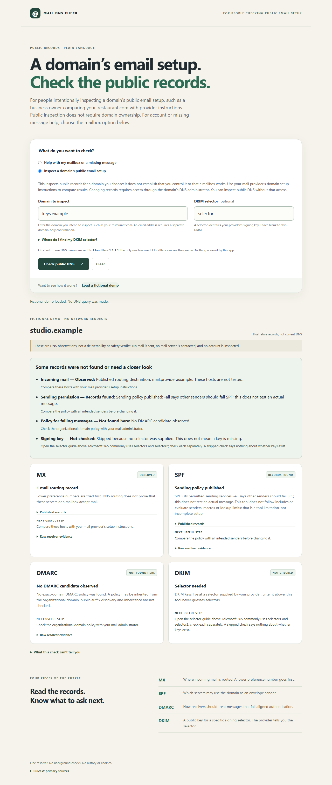

# Mail DNS Check


Choose mailbox help or intentional public-domain DNS inspection before entering anything. Mailbox help offers account and message-support next steps without collecting an address or querying DNS, for every provider. Public inspection (for example your-restaurant.com) does not require ownership; changing records requires the DNS administrator. This buildless browser-only inspector compares records with provider instructions and never diagnoses a mailbox or individual message. After choosing public inspection, enter a domain and explicitly
query Cloudflare 1.1.1.1, and read MX/SPF/DMARC plus an optional known DKIM selector.
Live observations and invented demo fixtures are separate. No mail, SMTP probes,
account access, scans, storage, guessed selectors or automatic background requests.

`npm test` runs the dependency-free Node core tests. `npm run preview` binds only
127.0.0.1:43220 for at most 20 minutes; stop with Ctrl+C. Static output is `dist/`; hosting is configured separately.

The sole network destination is https://cloudflare-dns.com/dns-query, with
credentials omitted, redirects rejected and no referrer. Explicit checks issue
three queries (MX, domain TXT, exact-domain DMARC TXT), or four with a supplied
DKIM selector. Concurrent requests share a 12-second cancellation deadline;
each streamed response is capped at 64 KiB and 100 answers. A new check, demo,
clear, cancel or page exit invalidates prior responses. Input is bounded, IDNs
are normalized to ASCII; URL/IP/local names are rejected. All domains require explicit public-DNS intent. Every email address requires domain-only confirmation; its local part is never sent to the resolver. Known provider names add context only: the finite provider list never establishes visitor intent or domain control. The resolver
sees the requested names; this app retains no history. CSP allows connections
only to that resolver. Public source links navigate only on an explicit click.

Interpretations are bounded record summaries, never authentication or
deliverability verdicts. Null MX can intentionally reject incoming mail; absent
MX can use A/AAAA fallback (not queried). SPF dependencies/macros/address matching
and lookup budgets are not evaluated. DMARC organizational-domain discovery and
inheritance are not evaluated. DKIM public keys/signatures are not validated.
CNAMEs remain visible in raw evidence without additional target queries. TXT
chunks are concatenated as one record; unrelated TXT records remain visible.
Unavailable/truncated/error responses are distinct from absent records. TTL is
resolver cache evidence, not a promise of global freshness.

Primary rules: [Cloudflare DoH JSON API](https://developers.cloudflare.com/1.1.1.1/encryption/dns-over-https/make-api-requests/dns-json/),
[SMTP RFC 5321 §5](https://www.rfc-editor.org/rfc/rfc5321.html#section-5),
[null MX RFC 7505](https://www.rfc-editor.org/rfc/rfc7505.html),
[SPF RFC 7208](https://www.rfc-editor.org/rfc/rfc7208.html),
[DMARC RFC 7489](https://www.rfc-editor.org/rfc/rfc7489.html),
[DKIM RFC 6376](https://www.rfc-editor.org/rfc/rfc6376.html).

## Source and verification



MIT licensed; see [LICENSE](LICENSE) and [third-party inventory](THIRD_PARTY_NOTICES.md).
Built by [Arcdrake](https://arcdrake.com/). The source is available in this repository; production hosting is being prepared.
See [verification](docs/VERIFICATION.md) and [deployment](docs/DEPLOYMENT.md). This source candidate does not establish a public deployment.

Requires Node.js 22+ for the local preview and core tests. No install is needed.
`npm test` runs deterministic core tests. `npm run package` requires Python 3.11+
and creates a checked static ZIP plus SHA-256 manifest in `artifacts/release/`.
There is no frontend compilation step; `dist/` is the application source.

For browser regression checks, follow the locked development setup below and run `npm run test:ci`. The script starts/stops its own preview and headless browser. Screenshots go to ignored `artifacts/readiness/`; only `UPDATE_SCREENSHOTS=1` replaces release images in `docs/`. Do not run it while
another process owns the app's preview port. No package/browser installation is
required for normal use. Chromium desktop and 390px emulation are recorded;
physical devices, screen readers and other engines are not newly verified.

For contributions, supply a reproducible issue with synthetic inputs only; never
attach real credentials or private URLs/domains. Run the relevant core/browser
checks with a proposed fix. [Report an issue](https://github.com/ArcdrakeStudios/mail-dns-check/issues).

## Local usability verification, 15 October 2026

16 deterministic core tests and 23 Chromium browser fixture checks pass. Mailbox-help journeys for known and unknown providers make no DNS queries. Unknown direct domains cannot bypass the intent gate; email addresses require domain-only confirmation after public-DNS intent. The result overview states routing destinations, sending policy and qualifier meaning, DMARC monitoring/enforcement and whether a signing key was found or skipped, with next actions. Raw records are collapsed. NXDOMAIN, unavailable answers, parse limitations and configuration concerns remain separate. Browser fixtures include ~all, p=none, a supplied selector1 key and the visible Microsoft 365 selector1/selector2 guide (not a provider-integration test), NXDOMAIN, unavailable answers and cancellation races. Updated synthetic desktop/mobile screenshots were visually inspected. This is local verification; production-origin testing remains separate.

## Source, support and development

[Source](https://github.com/ArcdrakeStudios/mail-dns-check) · [Issues](https://github.com/ArcdrakeStudios/mail-dns-check/issues) · [Contributing](CONTRIBUTING.md) · [Security](SECURITY.md)

Part of Arcdrake's tools collection. The planned shared home is `tools.arcdrake.com`;
production hosting is not live as part of this source release. Local use is available
above. Development checks use Node.js 24, Python 3 and locked Playwright tooling:

```sh
npm ci
npx playwright install chromium
npm test
npm run test:ci
npm run package:release
```

The CI wrapper starts and stops its own preview server. Runtime operation needs no
package installation. [Release procedure](docs/RELEASING.md).
